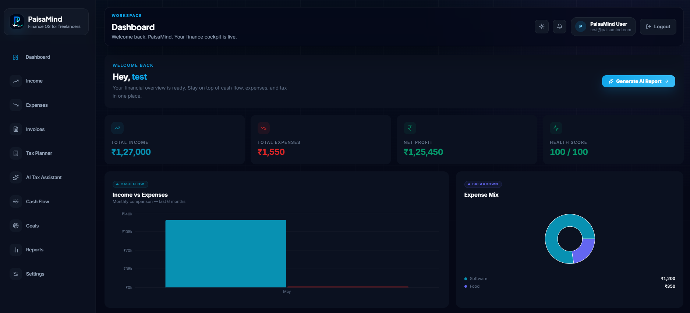
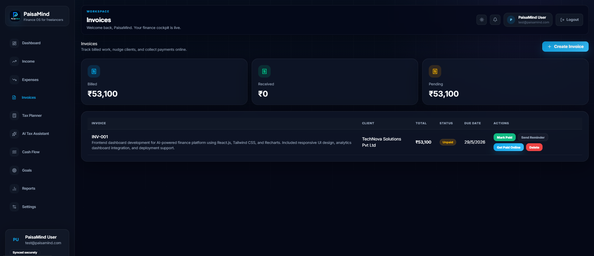

# PaisaMind

[](LICENSE)

Financial tracking and Indian tax planning for freelancers. Tracks income and expenses,
reconciles TDS against Form 26AS/AIS, compares Section 44ADA with the new tax regime,
and issues invoices with UPI QR codes.

Live: https://paisamind.netlify.app

## Who it's for

Independent professionals in India — developers, designers, consultants, writers — who
invoice several clients and file their own returns.

## What it does

- Log income and expenses by pasting a bank SMS, or by hand.
- Compare tax under Section 44ADA and the new regime, with every input shown.
- Match invoices against Form 26AS/AIS and list TDS you have not claimed.
- Generate invoices with a UPI QR code, so clients pay directly with no gateway fee.
- Warn before turnover crosses the ₹20 lakh GST threshold.
- Show cash runway alongside a coverage count, so estimated and known figures stay separate.

## Screenshots

### Dashboard


### Invoices with UPI QR


## Architecture

Client requests flow from React 19 through Vite to Netlify, communicating over HTTPS with an Express API on Render. The server validates payloads with Mongoose and stores persistent records in MongoDB Atlas, while authentication tokens are verified against Firebase Auth.

## How your data is handled

- Bank statements are parsed in your browser. The file is not uploaded.
- Only the extracted ledger rows sync, and only if you opt in.
- PAN is stored masked to the last four characters.
- Export everything to CSV at any time. Delete everything in one click.

## What it does not do

- It does not connect to your bank or ask for net banking credentials.
- It does not file your returns.
- It does not give investment or legal advice.
- Tax figures are estimates based on the inputs you provide.

## Future roadmap

- **Virtual accounts and UPI collect**: Dedicated per-client virtual bank accounts or UPI collect workflows require PSP merchant relationships and per-transaction fees; this is planned as an optional future feature.
- **Account Aggregator**: Read-only fetch via RBI Account Aggregator framework when standardized client SDKs become widely accessible.

## Running it locally

### Prerequisites
- Node.js >= 18
- MongoDB Atlas database cluster
- Firebase Project with Google Sign-In activated

### 1. Clone the repository
```bash
git clone https://github.com/AkshatKardak/PaisaMind.git
cd PaisaMind
```

### 2. Configure and start backend server
```bash
cd server
npm install
npm run dev
```

### 3. Configure and start frontend client
```bash
cd ../client
npm install
npm run dev
```

## Environment variables

| Variable | Needed in | Source |
|---|---|---|
| `PORT` | Backend | Port number (e.g. 5000) |
| `MONGO_URI` | Backend | MongoDB Atlas connection string |
| `CLIENT_URL` | Backend | Frontend URL (e.g. http://localhost:5173) |
| `FIREBASE_PROJECT_ID` | Backend | Firebase Admin console |
| `FIREBASE_CLIENT_EMAIL` | Backend | Firebase Admin service account |
| `FIREBASE_PRIVATE_KEY` | Backend | Firebase Admin service account |
| `GROQ_API_KEY` | Backend | Groq Cloud console (existing copilot, optional Phase 1 fallback) |
| `LLM_FALLBACK_ENABLED` | Backend | Set to false by default |
| `DATA_ENCRYPTION_KEY` | Backend | Self-generated: `openssl rand -base64 32` |
| `SMS_RETRIEVER_HASH` | Backend / Android | Hash of your signing certificate |
| `RAZORPAY_KEY_ID` | Backend | Razorpay dashboard (server-side only) |
| `RAZORPAY_KEY_SECRET` | Backend | Razorpay dashboard (server-side only) |
| `SWEEP_TOKEN` | Backend / CI | Self-generated: `openssl rand -hex 32` |
| `VITE_API_URL` | Frontend | Backend API URL (e.g. http://localhost:5000/api) |
| `VITE_FIREBASE_*` | Frontend | Firebase web app configuration |

## Tests

14 test files, 86 passing tests. Run `npm test` in `server/`.

## Licence

MIT
